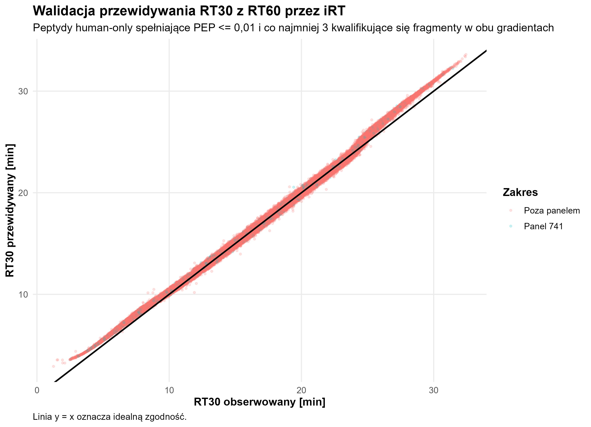
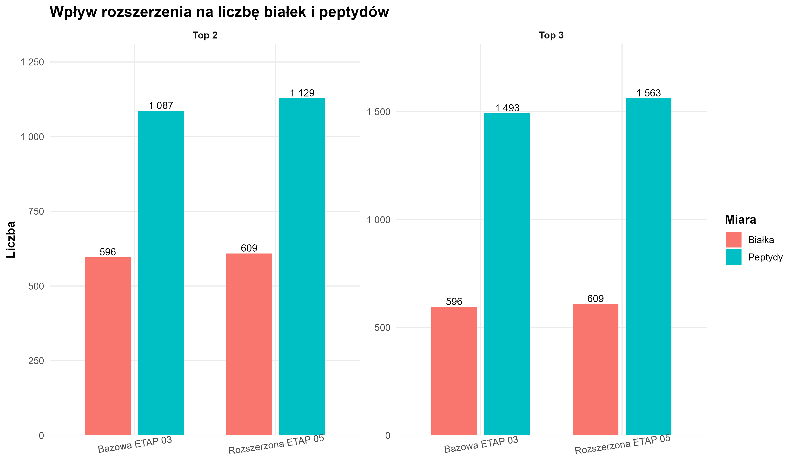

# PRM target list planning from DIA proteomics — MSc research

**Bioinformatics MSc research project · R · LC–MS/MS · DIA-NN · targeted proteomics**

An R workflow for selecting **protein-specific peptides and precursor candidates** for parallel reaction monitoring (PRM), integrating in-silico proteolytic digestion, DIA-derived identification evidence, fragment-ion quality and chromatographic retention-time information. Analysis targeted a **741-protein Homo sapiens panel**.

> **Scope:** Research pipeline from a completed academic analysis. The source DIA-NN reports and input FASTA/panel files are *not* included; a full rerun requires the external files listed below. Numerical results shown here were verified against the provided exported result tables, not independently recomputed from the original DIA input.

## Pipeline

| Stage | Script | Main purpose |
| --- | --- | --- |
| 1 | [`01_przygotowanie_fasta_i_trawienie_in_silico.R`](scripts/01_przygotowanie_fasta_i_trawienie_in_silico.R) | FASTA preparation, Trypsin/Lys-C digestion comparison, unique peptide candidates and ragged-end filters |
| 2 | [`02_kryteria_doswiadczalne_DIA_NN.R`](scripts/02_kryteria_doswiadczalne_DIA_NN.R) | Merge candidates with DIA-NN results, apply experimental criteria and score fragment evidence |
| 3 | [`03_listy_peptydowo_prekursorowe.R`](scripts/03_listy_peptydowo_prekursorowe.R) | Assemble candidate Top 2 / Top 3 precursor lists |
| 4 | [`04_okna_retencji_i_propozycje_zamian.R`](scripts/04_okna_retencji_i_propozycje_zamian.R) | Quantify chromatographic co-elution / window congestion and evaluate controlled peptide substitutions |
| 5 | [`05_kalibracja_iRT_i_listy_rozszerzone.R`](scripts/05_kalibracja_iRT_i_listy_rozszerzone.R) | Calibrate iRT between 60- and 30-minute gradients; expand candidate lists |

## Selected results

The reported experimental filters and fragment evidence identified **596 of 741 panel proteins** for the baseline 30-minute list. Integration of additional 60-minute data increased the coverage to **609 proteins**, i.e. **13 additional proteins**.

| List | Baseline peptides | Extended peptides | Proteins baseline → extended |
| --- | ---: | ---: | --- |
| Top 2 | 1,087 | 1,129 | 596 → 609 |
| Top 3 | 1,493 | 1,563 | 596 → 609 |

For the extended **Top 3** list, **32** added peptides relied on predicted 30-minute retention times (genuinely absent from the 30-minute detections), while **38** had observed 30-minute RT and usable quality evidence from the 60-minute data.

The iRT transfer validation on **4,033 shared panel peptides** reported **MAE 0.3328 min**, **RMSE 0.4235 min**, **95th-percentile absolute error 0.8943 min**, and **R² 0.9970**. This is a within-data transfer validation and is **not** proof of performance on other chromatographic systems.

See reproducible summary outputs in [`results/summaries/`](results/summaries/) and plots in [`results/figures/`](results/figures/). The source exports contain Polish column names and decimal commas.

## Environment and execution

**R packages:** `tidyverse`, `readxl`, `openxlsx`, `ggplot2`, `arrow`, `scales`. The code expects external files in a working directory and automatically locates prior stage outputs in that area.

Required inputs (not bundled):

1. Human reference proteome FASTA with technical iRT standards;
2. Excel file containing the 741-protein target panel;
3. Four DIA-NN `--export-quant` reports in Parquet format: two 30-minute measurements and two 60-minute runs.

From a properly populated project working directory, execute scripts **01 → 02 → 03 → 04 → 05**. Consult [`docs/README.txt`](docs/README.txt) and [`docs/WEJSCIA_DO_PIPELINE.txt`](docs/WEJSCIA_DO_PIPELINE.txt) for original Polish file names and expected inputs. The scripts have not been independently rerun in this portfolio snapshot because input datasets were not provided.

## Research limitations

- Not every panel protein was detectable under the selected experimental conditions and filters; **609 / 741** is list coverage, not an assay-level sensitivity estimate.
- Retention-time prediction supports scheduling candidate measurements but does **not** replace instrument method review and validation in Skyline.
- The 95th-percentile RT error is an approximate guide, **not** a validated scheduled-PRM window.
- Large raw/processed datasets are omitted intentionally; obtain appropriate rights and permissions before any release of full experimental data.

**Author:** Daniel Drabik · Jagiellonian University · Master's research.
